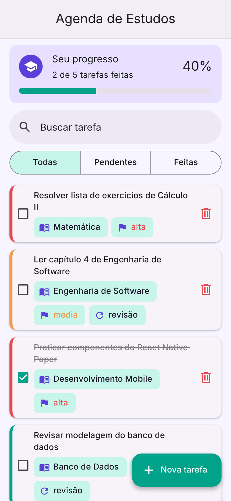
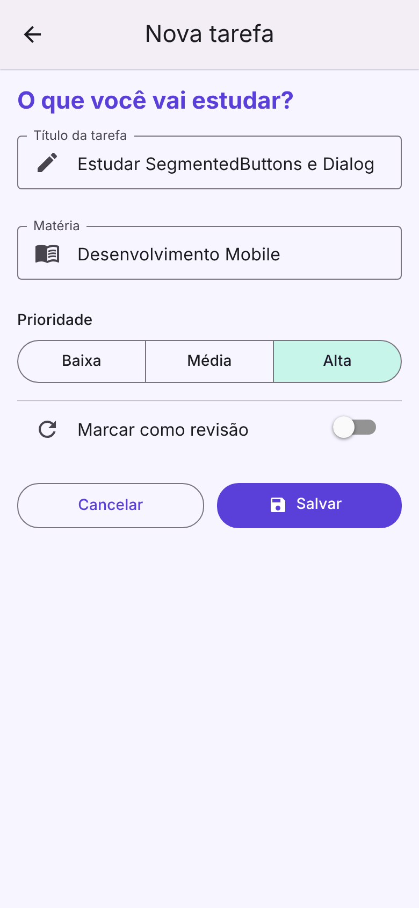
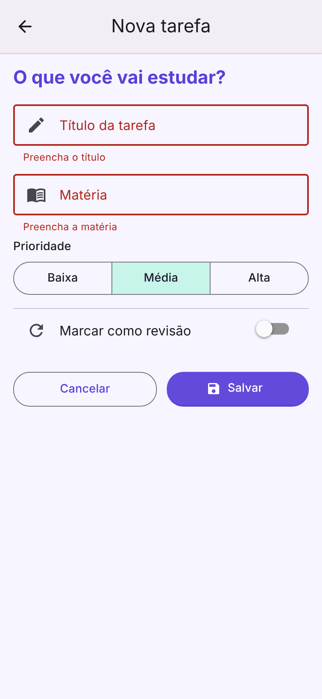
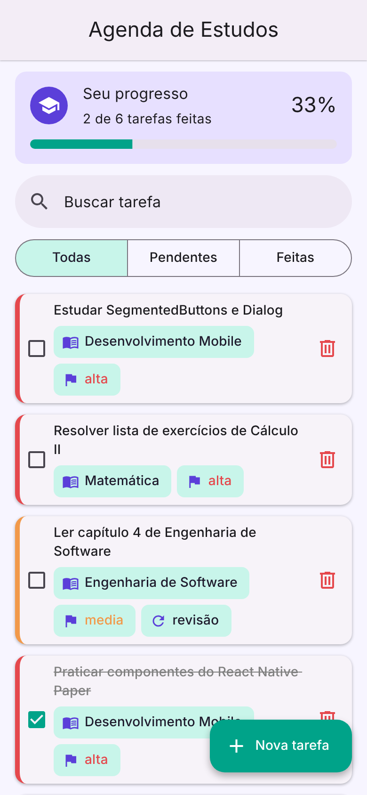
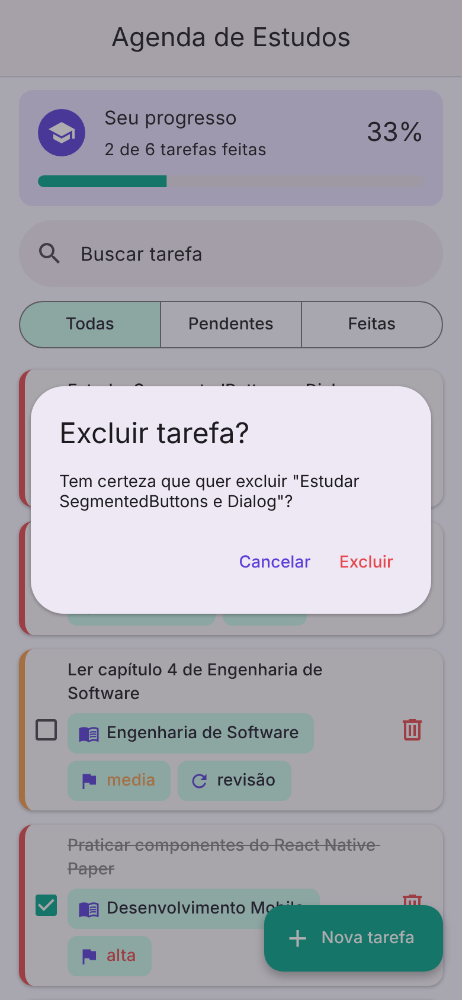
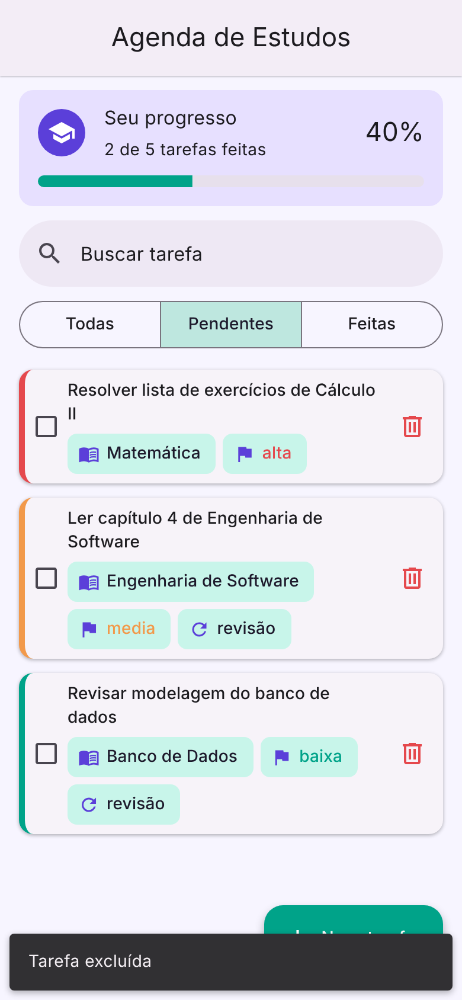

# Agenda de Estudos — React Native Paper

**Aluna:** Stéphany Lima Vital
**Disciplina:** Desenvolvimento de Aplicativos Móveis Avançado — Prof. Renato de Sousa Gomide
**Atividade:** Bibliotecas de componentes visuais de terceiros

---

## Parte 1 — Pesquisa sobre a biblioteca

> Dados consultados em 15/11/2026.

### 1. Identificação

| Item | Informação |
|---|---|
| Nome | **React Native Paper** (`react-native-paper`) |
| Documentação oficial | https://callstack.github.io/react-native-paper/ |
| Repositório | https://github.com/callstack/react-native-paper |
| Página no npm | https://www.npmjs.com/package/react-native-paper |
| Licença | **MIT** (livre para uso pessoal e comercial) |

### 2. Manutenção

- **Mantida por:** [Callstack](https://www.callstack.com/open-source), uma empresa especializada em React Native, junto com contribuidores da comunidade.
- **Última versão estável:** `5.15.4`, publicada em **02/11/2026** (fonte: registro do npm, `npm view react-native-paper time`). A versão `6.0.0-alpha.2` já está em testes, o que mostra que o projeto está ativo.

### 3. Popularidade

- **Estrelas no GitHub:** cerca de **14,5 mil** ([star-history.com](https://www.star-history.com/callstack/react-native-paper), out/2026).
- **Downloads semanais no npm:** **614.577** (semana de 08/11 a 14/11/2026 — [API de downloads do npm](https://api.npmjs.org/downloads/point/last-week/react-native-paper)).

### 4. Plataformas e compatibilidade com o Expo

- **Plataformas:** Android, iOS e Web (via `react-native-web`).
- **Expo:** funciona direto no **Expo Go**, sem precisar de development build. A biblioteca é escrita em JavaScript/TypeScript puro e não tem código nativo próprio; suas dependências (`react-native-safe-area-context` e os ícones de `@expo/vector-icons`) já vêm no Expo Go.

### 5. Instalação e configuração

```bash
npx expo install react-native-paper react-native-safe-area-context
```

Configuração necessária:

1. Envolver o app com o `PaperProvider` (opcionalmente passando um `theme`).
2. Ter um `SafeAreaProvider` por volta do app (usado pelo `Appbar.Header`).
3. **Não precisa de plugins no `app.json`.** Opcionalmente, dá para adicionar o plugin `react-native-paper/babel` no `babel.config.js` para diminuir o tamanho do bundle em produção.

```jsx
import { PaperProvider } from 'react-native-paper';

export default function App() {
  return (
    <PaperProvider theme={meuTema}>
      <Rotas />
    </PaperProvider>
  );
}
```

### 6. Principais componentes

| Componente | Descrição |
|---|---|
| `Appbar` | Barra superior com título, botão de voltar e ações. |
| `Card` | Cartão com título, conteúdo, capa e ações; tem os modos `elevated`, `outlined` e `contained`. |
| `TextInput` | Campo de texto nos estilos `flat` e `outlined`, com rótulo animado, ícones e estado de erro. |
| `Button` | Botão nos modos `text`, `outlined`, `contained`, `elevated` e `contained-tonal`. |
| `FAB` | Botão de ação flutuante, com ícone e rótulo opcional. |
| `Dialog` + `Portal` | Caixa de diálogo modal, renderizada por cima da tela. |
| `Snackbar` | Mensagem curta e temporária na parte de baixo da tela. |
| `SegmentedButtons` | Grupo de botões para escolher uma opção (funciona como abas ou filtro). |
| `Chip` | Etiqueta compacta com ícone; serve para categorias e filtros. |
| `Checkbox`, `Switch` | Controles de seleção e de liga/desliga. |
| `Searchbar` | Campo de busca com ícone. |
| `ProgressBar` | Barra de progresso determinada ou indeterminada. |
| `List` | Itens de lista com título, descrição e ícones à esquerda/direita. |

### 7. Personalização da aparência

- **Tema global:** cria-se um objeto baseado em `MD3LightTheme`/`MD3DarkTheme`, trocando `colors`, `roundness` e `fonts`, e passa-se esse objeto para o `PaperProvider`. Todos os componentes passam a usar essas cores.
- **Tipografia:** a função `configureFonts` muda as variantes de texto (`titleLarge`, `bodyMedium`...).
- **Modo escuro:** basta trocar o tema passado para o `PaperProvider`.
- **Por componente:** props como `mode`, `color`, `textColor`, `buttonColor`, `iconColor`, `style` e `textStyle`.
- **Dentro de componentes:** o hook `useTheme()` dá acesso às cores do tema atual.

### 8. Pontos positivos e negativos (observados no uso)

**Positivos**
- Visual consistente com o Material Design 3 desde o primeiro componente, sem precisar estilizar nada.
- Roda no Expo Go sem configuração extra, inclusive na Web.
- O sistema de temas facilita muito: com um único objeto troquei a paleta inteira do app.
- Documentação com exemplos de cada componente e de suas props.
- Boa acessibilidade (props `accessibilityLabel`, áreas de toque adequadas).

**Negativos**
- O visual é muito "Google/Android"; no iOS o app não parece nativo, e fugir do Material Design dá trabalho.
- Alguns componentes têm pequenas diferenças na Web (por exemplo, o espaçamento interno do `Card`).
- O `Dialog` e o `Snackbar` exigem entender o `Portal` para aparecerem por cima de tudo.
- Faltam componentes mais complexos, como calendário, seletor de data ou gráficos, que precisam de outras bibliotecas.

### 9. Comparação com uma alternativa: React Native Elements (`@rneui/themed`)

| Critério | React Native Paper | React Native Elements |
|---|---|---|
| Padrão visual | Material Design 3 | Neutro, multiplataforma |
| Downloads semanais (npm, 08–14/11/2026) | ~614 mil | ~65 mil |
| Mantenedor | Callstack (empresa) + comunidade | Comunidade |
| Temas claro/escuro | Prontos (MD3) | Precisa configurar |
| Expo Go | Sim | Sim |

**Por que escolhi o Paper:** ele é usado quase 10 vezes mais, é mantido por uma empresa referência em React Native e recebe atualizações com frequência. O que mais pesou foi ter um sistema de temas completo (cores, tipografia, modo escuro) já pronto, o que me deixou focar nas funcionalidades do app. O Elements seria melhor se eu quisesse um visual neutro e longe do Material Design.

**Fontes:** [documentação oficial](https://callstack.github.io/react-native-paper/) · [GitHub](https://github.com/callstack/react-native-paper) · [npm](https://www.npmjs.com/package/react-native-paper) · [npm downloads API](https://api.npmjs.org/downloads/point/last-week/react-native-paper) · [star-history](https://www.star-history.com/callstack/react-native-paper) · [npm @rneui/themed](https://www.npmjs.com/package/@rneui/themed)

---

## Parte 2 — Projeto de exemplo

**Agenda de Estudos** é um app para organizar tarefas de estudo. Nele é possível cadastrar tarefas com matéria e prioridade, marcar como feitas, filtrar, buscar e excluir com confirmação.

### Como executar

```bash
npm install
npx expo start
```

Depois é só ler o QR Code com o Expo Go, ou apertar `a` (Android) ou `w` (Web) no terminal.

### Estrutura de pastas

```
App.js
src/
├── components/
│   └── TarefaCard.js
├── data/
│   └── tarefas.js
├── screens/
│   ├── TarefasScreen.js
│   └── NovaTarefaScreen.js
└── theme/
    └── tema.js
```

### Componentes do React Native Paper usados

| Componente | Arquivo(s) |
|---|---|
| `PaperProvider` | `App.js` |
| `MD3LightTheme` (tema personalizado) | `src/theme/tema.js` |
| `Appbar` (`Header`, `Content`, `BackAction`) | `src/screens/TarefasScreen.js`, `src/screens/NovaTarefaScreen.js` |
| `Card` (`Title`, `Content`) | `src/screens/TarefasScreen.js`, `src/components/TarefaCard.js` |
| `Avatar.Icon` | `src/screens/TarefasScreen.js` |
| `ProgressBar` | `src/screens/TarefasScreen.js` |
| `Searchbar` | `src/screens/TarefasScreen.js` |
| `SegmentedButtons` | `src/screens/TarefasScreen.js`, `src/screens/NovaTarefaScreen.js` |
| `FAB` | `src/screens/TarefasScreen.js` |
| `Portal` + `Dialog` | `src/screens/TarefasScreen.js` |
| `Snackbar` | `src/screens/TarefasScreen.js` |
| `Button` | `src/screens/TarefasScreen.js`, `src/screens/NovaTarefaScreen.js` |
| `Text` | todas as telas e `src/components/TarefaCard.js` |
| `Checkbox`, `Chip`, `IconButton` | `src/components/TarefaCard.js` |
| `TextInput`, `HelperText`, `Switch`, `List.Item`, `Divider` | `src/screens/NovaTarefaScreen.js` |

### Requisitos

- **Navegação:** duas telas (`Tarefas` e `NovaTarefa`) com stack navigator. A nova tarefa volta para a lista por `route.params`.
- **useState:** cadastro, marcar como feita, excluir (Dialog), busca e filtro.
- **Lista:** vetor local em `src/data/tarefas.js` mostrado numa `FlatList` com `Card`.
- **Personalização:** tema próprio (cores roxo/verde-água e `roundness`) e cores diferentes por prioridade.

### Capturas de tela

| Lista de tarefas | Nova tarefa | Validação |
|---|---|---|
|  |  |  |

| Tarefa adicionada | Excluir tarefa | Snackbar + filtro |
|---|---|---|
|  |  |  |
